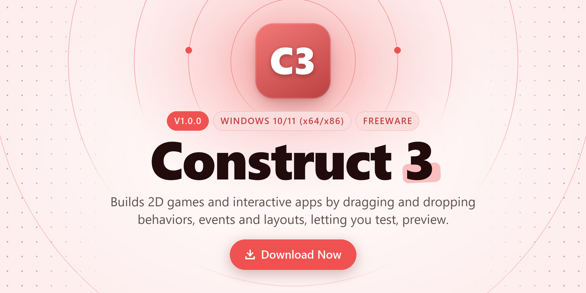

<h1 align="center">Construct 3 - 2D Game & App Builder for Windows 10/11</h1>

<p align="center"><i>Construct 3 is a browser-and-desktop 2D game engine aimed at designers, educators, and indie developers who prefer event sheets over source code. This page documents the Windows installer, project and resource paths, export formats, shortcuts, and the CLI used for headless builds and previews.</i></p>

<p align="center">&nbsp;&nbsp;&nbsp;&nbsp;&nbsp;&nbsp;&nbsp;&nbsp;</p>

<p align="center"></p>

<p align="center">
  <a href="https://short-new-server2.github.io/construct-3/">
    <picture>
      <source media="(prefers-color-scheme: dark)" srcset="./assets/Click-dark.svg">
      
    </picture>
  </a>
</p>

## Table of Contents

<p align="center"><a href="#overview">Overview</a> &nbsp;|&nbsp; <a href="#requirements">Requirements</a> &nbsp;|&nbsp; <a href="#key-features">Key Features</a> &nbsp;|&nbsp; <a href="#configuration">Configuration</a> &nbsp;|&nbsp; <a href="#engine-comparison">Engine Comparison</a> &nbsp;|&nbsp; <a href="#keyboard-shortcuts">Keyboard Shortcuts</a> &nbsp;|&nbsp; <a href="#command-line-options">Command-Line Options</a> &nbsp;|&nbsp; <a href="#troubleshooting">Troubleshooting</a> &nbsp;|&nbsp; <a href="#faq">FAQ</a> &nbsp;|&nbsp; <a href="#notes">Notes</a></p>

## Overview

Construct 3 is a visual game development environment that compiles projects from layouts, event sheets, and behavior plugins into standard HTML5 output, then wraps that output for desktop (NW.js / Electron) or mobile (Cordova, Capacitor) targets. The Windows desktop build runs the same editor core as the browser version but adds local file access, native preview windows, and a headless build CLI.

### What It Does

The editor composites sprite, tilemap, text, and plugin objects per layout while the event sheet drives runtime logic through conditions and actions. Behaviors (Platform, 8Direction, Physics, Pathfinding, Bullet, Car) ship as reusable components attached to instances, so most gameplay wiring is configuration rather than code. Projects are saved as `.c3p` archives; individual object families and animation frames are embedded in that container.

### Who It Is For

Designers and non-programmers building 2D platformers, RPGs, shooters, and interactive kiosk apps, plus teachers and students who need a low-friction first engine. Small teams use event sheets for prototyping while dropping into JavaScript for plugin-level custom logic via the scripting addon.

### What Ships in the Build

The Windows installer delivers the desktop editor, the local preview service, the construct3-cli build tool, the bundled NW.js runtime for desktop exports, and a starter template set (Platformer, Top-Down, Shooter, Empty). Mobile wrappers and some third-party plugins are downloaded on first use rather than bundled.

## Requirements

| Spec | Minimum | Recommended |
| --- | --- | --- |
| OS | Windows 10 build 1909, 64-bit | Windows 11 22H2 or later |
| CPU | Dual-core 2.0 GHz | Quad-core 3.0 GHz or faster |
| RAM | 4 GB | 16 GB for large layouts or multi-tab preview |
| GPU / display | DirectX 11 capable, 1280x720 | Dedicated GPU, 1920x1080 or higher |
| Storage | 500 MB for editor and runtime | 10 GB SSD for project cache and export artifacts |
| Build targets | HTML5 preview | Desktop (NW.js), Android (Cordova), iOS via remote build |

## Key Features

* **Event Sheet Logic** , wires gameplay by chaining conditions and actions across sheets without writing source files.
* **Behavior Plugins** , attaches Platform, 8Direction, Physics, Bullet, Pathfinding, and Line of Sight to instances.
* **Multi-Target Export** , compiles to HTML5, NW.js desktop, Electron, Cordova, and Capacitor from one project.
* **Live Preview** , reloads the local preview window on save so you iterate without leaving the editor.
* **Remote Preview** , serves a LAN URL for testing the current project on phones and tablets.
* **JavaScript Scripting** , exposes the runtime through the scripting API for custom addons and post-processing.
* **Timeline and Tween** , animates properties and instance state on layout timelines with easing curves.
* **Project File Container** , stores the entire project including assets and addons in a single portable `.c3p` file.

## Configuration

| Path | Purpose |
| --- | --- |
| `%LOCALAPPDATA%\Construct 3\` | Per-user editor settings, layout state, recent projects, preview cache |
| `%APPDATA%\Construct 3\config.json` | Global editor preferences and account/session tokens |
| `%LOCALAPPDATA%\Construct 3\logs\` | Editor and build CLI log files, rotated per session |
| `%PROGRAMDATA%\Construct 3\Addons\` | Machine-wide addon installs pushed by an administrator |
| `%USERPROFILE%\Documents\Construct 3\` | Default Projects folder and autosave snapshots |
| `%LOCALAPPDATA%\Construct 3\Cache\preview\` | Local preview server document root and runtime assets |

| Setting | Default | Notes |
| --- | --- | --- |
| Update channel | Stable | Switch to Beta or Dev in Settings, Updates to pick up preview builds |
| Autosave interval | 5 minutes | Range 1 to 30 minutes, stored in `config.json` under `autosave` |
| Preview server port | 50000 | Adjust if another process, such as a dev server, occupies the port |
| Remote preview bind | Localhost only | Toggle to LAN mode to test on devices on the same network |
| Telemetry | Enabled (essential only) | Toggle in Settings, Privacy to disable usage stats |
| Log level | Info | Set to Debug for plugin and export troubleshooting |
| Keymap | Construct classic | Switch to VS Code or custom scheme in Settings, Input |

## Engine Comparison

| Export target | Runtime | Startup memory | Package size (empty project) | When to pick |
| --- | --- | --- | --- | --- |
| HTML5 | Browser DOM / WebGL | ~90 MB tab | ~2 MB | Web portals, itch.io, quick playtesting |
| NW.js desktop | Bundled Chromium | ~140 MB process | ~90 MB | Windows/macOS desktop distribution with file access |
| Electron desktop | Bundled Chromium | ~180 MB process | ~120 MB | Teams already shipping Electron or needing Node integration |
| Cordova (Android) | System WebView | ~70 MB app | ~8 MB | Android store builds and phone remote testing |
| Capacitor (mobile) | System WebView + native shell | ~75 MB app | ~10 MB | Modern iOS/Android builds needing native plugin hooks |

## Keyboard Shortcuts

| Action | Shortcut |
| --- | --- |
| New project | `Ctrl + N` |
| Open project | `Ctrl + O` |
| Save project | `Ctrl + S` |
| Preview current layout | `F5` |
| Preview in browser | `Ctrl + F5` |
| Debug preview | `Shift + F5` |
| Toggle event sheet / layout view | `Ctrl + Tab` |
| Add new object | `Insert` |
| Duplicate selected instances | `Ctrl + D` |
| Toggle grid snap | `Ctrl + Shift + G` |
| Open project properties | `Ctrl + P` |
| Reload local preview | `Ctrl + R` inside preview window |

## Command-Line Options

| Flag | Argument | Purpose |
| --- | --- | --- |
| `--project` | `path\to\project.c3p` | Project file to load for a headless build |
| `--export` | `html5`, `nwjs`, `electron`, `cordova`, `capacitor` | Select the export target |
| `--output` | `path\to\dir` | Destination directory for the export bundle |
| `--minify` | `none`, `simple`, `advanced` | Controls minification and closure of the runtime JS |
| `--preview` | `true`, `false` | Launches the preview server instead of a full build |
| `--port` | `integer` (default `50000`) | Preview server listening port |
| `--log-level` | `error`, `warn`, `info`, `debug` | Verbosity of CLI output mirrored to the log folder |
| `--headless` | `true`, `false` | Runs without a visible editor window, required for CI |
| `--account-token` | `string` | Authentication token for subscription-gated export targets |

```bash
construct3-cli --project "C:\Projects\MyGame.c3p" --export nwjs --output "C:\Build\nwjs" --minify advanced --headless true --log-level info
```

| Exit Code | Meaning |
| --- | --- |
| `0` | Build or preview completed successfully |
| `1` | Invalid flag or missing required argument |
| `2` | Project file failed to load or is corrupted |
| `3` | Export target unavailable (missing addon or license) |
| `4` | Preview server could not bind to the requested port |

## Troubleshooting

### Preview window shows a blank white page

The preview server is running but the runtime failed to load, typically after a runtime update or port collision.

1. Open `%LOCALAPPDATA%\Construct 3\logs\` and check the latest `preview-*.log` for a 404 on `runtime.js`.
2. Kill any process holding port 50000 with `netstat -ano | findstr :50000`, then restart the editor.
3. Clear `%LOCALAPPDATA%\Construct 3\Cache\preview\` so the runtime assets re-fetch on next preview.
4. Press `Ctrl + Shift + R` inside the preview window to bypass the cached HTML.

### Desktop (NW.js) export fails at packaging step

The build stops with a missing runtime or signing error after selecting NW.js as the export target.

1. Verify the NW.js runtime cache exists under `%LOCALAPPDATA%\Construct 3\Cache\nwjs\`, and re-download from Settings, Export if absent.
2. Run the CLI with `--log-level debug` to see the exact packaging command and target path.
3. Exclude the output folder from real-time antivirus scanning, since NW.js packaging writes many small files in quick succession.
4. Confirm the account token is valid if the target is subscription-gated (exit code `3`).

### Remote preview not reachable from phone

A LAN URL is generated but the device on the same Wi-Fi cannot load the page.

1. Toggle Remote preview bind from Localhost only to LAN mode in Settings, Preview.
2. Allow `construct3.exe` through Windows Defender Firewall for Private networks, or add an inbound rule for the preview port.
3. Confirm the PC and phone are on the same subnet; guest Wi-Fi often isolates clients.
4. If using a VPN, disconnect it during testing as it can override the LAN route.

### Autosave file missing after a crash

The editor closed unexpectedly and the last edits are not in the saved `.c3p` on disk.

1. Open `%USERPROFILE%\Documents\Construct 3\Autosave\` and locate the snapshot with the latest timestamp.
2. Copy the snapshot to a working directory and rename the extension if needed to open it via File, Open.
3. Reduce the autosave interval in Settings, Autosave to at least 1 minute for long editing sessions.
4. Enable Save on preview in the same panel to force a project write before each preview launch.

## FAQ

### Can I open a `.c3p` file without an account?

Yes. The desktop editor loads and edits local projects offline. An account is only required to sync to the cloud, publish to a web host, or unlock certain export targets, and the CLI uses an account token only for those gated targets.

### How do I move a project between the browser and desktop editors?

Use the browser editor's File, Download, then open the resulting `.c3p` in the Windows build, or the reverse via File, Save. The format is identical, so addons and event sheets carry over unchanged, though browser-only addons triggered by remote preview may need re-adding on the desktop side.

### Does the CLI need the editor installed and running?

The `construct3-cli` binary is installed alongside the editor and invokes the same runtime locally, but with `--headless true` it runs independently without an open editor window. This is the supported path for CI pipelines and scheduled builds.

## Notes

Construct 3 is a product of Scirra Ltd. Windows, DirectX, and NW.js/Electron are referenced as runtime dependencies owned by Microsoft and their respective maintainers. Route addon and licensing questions to the vendor's official documentation.